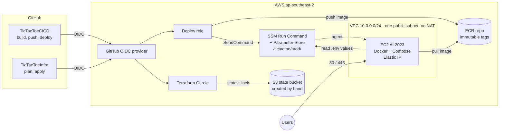

# TicTacToeCICD

A small full-stack Next.js app (register/login, tic-tac-toe against a bot, PostgreSQL) used as the
sample workload for a CI/CD pipeline: GitHub Actions → Amazon ECR → EC2 via AWS SSM.
The pipeline is the point of the project; see `GOALS.md` for scope and status.

Live demo: <https://tictactoe.johe.my.id> (HTTPS through Caddy on the EC2 instance).

AWS infrastructure lives in a separate Terraform repo, **[TicTacToeInfra](https://github.com/joheee/TicTacToeInfra)**.
This repo never creates AWS resources.

## Architecture



This repo is the left-hand `TicTacToeCICD` box. Everything inside the AWS box is created by
[TicTacToeInfra](https://github.com/joheee/TicTacToeInfra); the pipeline only uses it.

## Run locally

Requires Docker with Compose. Node 22 is only needed for the dev-server option.

### Option 1: everything in Docker Compose

```bash
cp .env.example .env        # then set POSTGRES_PASSWORD to something of your own
docker compose up --build
```

Compose starts Postgres, runs the migrations to completion, then starts the app.
Open <http://localhost:3000>, register a user and play.

Health check: <http://localhost:3000/api/health> returns `{"status":"ok","db":"up","version":"dev"}`.

Stop it with `docker compose down` (add `-v` to also delete the database volume).

### Option 2: Next.js dev server on the host, Postgres in Docker

```bash
cp .env.example .env
npm ci
npm run db:up               # starts only Postgres, on 127.0.0.1:${DB_PORT:-5433}
```

Create `.env.local` with the same user, password and database as `.env`, using the host port:

```
DATABASE_URL=postgres://app:<your-password>@localhost:5433/tictactoe
```

Then:

```bash
npm run migrate            # applies migrations/ to the database
npm run dev                # http://localhost:3000
```

`.env` and `.env.local` are git-ignored. Never commit them.

### Useful commands

| Command | What it does |
|---|---|
| `npm run lint` | ESLint |
| `npm run typecheck` | `tsc --noEmit` |
| `npm test` | Unit tests (Vitest, no database needed) |
| `npm run db:generate` | Generate a SQL migration after changing `src/lib/schema.ts` |
| `npm run migrate` | Apply migrations to the database in `.env` |

## CI

Workflow: [`.github/workflows/ci.yml`](.github/workflows/ci.yml). It runs on every pull request and on
every push to `main`, and it never deploys or touches AWS (no credentials, no secrets).

| Job | Steps |
|---|---|
| **Lint, type-check, test, audit** | Node 22, `npm ci`, `npm run lint`, `npm run typecheck`, `npm test`, `npm audit --omit=dev --audit-level=high` |
| **Secret scan** | [gitleaks](https://github.com/gitleaks/gitleaks) over the whole git history |
| **Docker build and scan** | Builds the `Dockerfile` with Buildx, tagged with the git SHA, `push: false`, then scans the image with [Trivy](https://github.com/aquasecurity/trivy) (fails on fixable HIGH or CRITICAL findings) |

- The three jobs run in parallel, so a failure in any one fails the check.
- The Docker job passes `APP_VERSION=<git SHA>`, the same build argument the release build will use,
  so `/api/health` reports which commit is running.
- A push to `main` that only changes Markdown files (`**.md`) skips CI, so Deploy does not run either (it
  follows CI). Pull requests always run CI, so the required checks can report. Run Deploy by hand if you
  ever need to ship a docs-only commit.
- A new push to a PR cancels that PR's older run. Runs on `main` are never cancelled.
- To make the checks block merges, require them in the repository's branch protection rules for
  `main` (a GitHub setting, not part of this repo).

### Supply chain

- **Pinned actions.** Every third-party action in `ci.yml` and `deploy.yml` is pinned to a full commit SHA
  (the tag is in a comment), and gitleaks to an image digest, so a moved tag cannot change what runs in the
  pipeline. [Dependabot](.github/dependabot.yml) opens weekly PRs for actions, npm packages, the Dockerfile
  base image and the Compose images; each PR has to pass CI.
- **Accepted findings.** The npm audit gate blocks *high* and *critical* vulnerabilities in production
  dependencies (it ignores dev-only tools such as `vitest`, which never reach the image). The Trivy
  exceptions are in [`.trivyignore`](.trivyignore), each with the reason; the file is empty today. Remove an
  entry when its fix ships.
- **Base image.** The Dockerfile stays on Node 22 LTS to match CI. Close a Dependabot PR that jumps the
  base image to a newer major unless the CI Node version moves with it.
- **Smaller image.** The runner stage deletes npm, npx, corepack and yarn. The app only needs `node`, and the
  package manager's own bundled dependencies were most of the image's findings.
- **Credentials.** Checkouts use `persist-credentials: false`, and the workflows' `GITHUB_TOKEN` is read-only
  (`contents: read`, plus `id-token: write` in the deploy job for OIDC).
- **GitHub settings** (not part of this repo): protect `main` and require the three CI checks (*Lint,
  type-check, test, audit*, *Secret scan*, *Docker build and scan*) plus a reviewed PR; turn on Dependabot
  alerts and secret scanning under Settings → Code security.
- **Do not add `environment: production` to the deploy job** without changing TicTacToeInfra first. It
  changes the OIDC subject claim to `...:environment:production`, so the deploy role, which trusts `main`,
  would refuse the login.

Run the same checks locally before pushing:

```bash
npm ci && npm run lint && npm run typecheck && npm test && npm audit --omit=dev --audit-level=high
docker build --build-arg APP_VERSION=local -t tictactoe-app:check .
```

## Deploy

Workflow: [`.github/workflows/deploy.yml`](.github/workflows/deploy.yml). It runs after **CI passes on a
push to `main`** (never for PRs), or by hand from the Actions tab. Only one deploy runs at a time.

| Step | What happens |
|---|---|
| AWS login | GitHub OIDC → the deploy role from TicTacToeInfra. No AWS keys are stored anywhere. |
| Build and push | Same Dockerfile and `APP_VERSION` as CI, pushed to ECR as `<git SHA>`. Skipped if that tag is already in ECR (tags are immutable). |
| Deploy | [`deploy/ssm-run.sh`](deploy/ssm-run.sh) sends [`deploy/remote/deploy.sh`](deploy/remote/deploy.sh), `docker-compose.yml` and the `Caddyfile` to the instance with SSM Run Command (no SSH). On the instance it writes `/opt/app/.env` from Parameter Store, logs in to ECR, pulls, runs the `migrate` service, then starts the new app and the Caddy proxy. |
| Smoke test | [`deploy/smoke-test.sh`](deploy/smoke-test.sh) checks `APP_URL/api/health` returns 200 with `"version": "<git SHA>"` and `/login` returns 200, retrying for up to 2 minutes. |
| Mark good | Writes the SHA to `/opt/app/last_good_tag` (history in `/opt/app/deploy_history`). |
| Rollback | If the deploy or smoke test fails: redeploys `last_good_tag`, smoke tests it, and the run ends red. |

### Proof: a bad deploy rolling itself back

Run [#41087349024](https://github.com/joheee/TicTacToeCICD/actions/runs/41087349024) (30 Oct 2026) was started
by hand with `break_health` on. It built and pushed `<git SHA>-broken`, deployed it, and the **smoke test
failed** because `/api/health` returned 503. "Mark as last good" was skipped, **"Roll back to last good"
redeployed the previous tag** with no manual step, and the run ended red on purpose.

### HTTPS

A [Caddy](https://caddyserver.com) container (`proxy` service, [`Caddyfile`](Caddyfile)) terminates TLS on
ports 80 and 443 and forwards to the app on the Compose network. It gets and renews its Let's Encrypt
certificate by itself (stored in the `caddy_data` volume) and redirects `http://` to `https://`.
Caddy also adds security headers (HSTS, `X-Content-Type-Options`, `X-Frame-Options`, `Referrer-Policy`,
`Permissions-Policy`, a CSP limited to framing and form targets) and removes `X-Powered-By`. HSTS is only
switched on by the EC2 deploy (`HSTS_MAX_AGE`, 1 year), never locally. The CSP has no `script-src` on purpose:
Next.js hydrates with inline scripts, so a strict one would break the app.
The app port is bound to `127.0.0.1` only, so the proxy is the only way in from outside.
The proxy is a Compose profile: off for a local `docker compose up`, on for EC2 (the deploy sets
`COMPOSE_PROFILES=proxy` in `.env`). The site name comes from `SITE_ADDRESS`; production uses
`tictactoe.johe.my.id`.

Try the proxy locally with `COMPOSE_PROFILES=proxy docker compose up --build` and open <https://localhost>
(Caddy issues a local certificate; your browser will ask you to trust it).

### App protection

The app itself guards the two public forms (`src/lib/actions.ts`, `src/lib/rateLimit.ts`):

- **Rate limits.** Login: 10 failed attempts per IP and 10 per username in 15 minutes. Register: 10 attempts
  per IP per hour. The client IP comes from `X-Forwarded-For`, which Caddy sets itself (it drops any value
  the client sends). The counters live in memory, so a deploy resets them.
- **No username leak.** Login always runs a bcrypt compare (against a dummy hash when the user does not
  exist), so response time does not reveal which usernames exist.
- **Password limits.** 8 to 72 bytes (bcrypt ignores everything after 72); register asks for the password
  twice and the server checks that they match.


### One-time setup

1. Apply TicTacToeInfra.
2. Set the real values in Parameter Store (in TicTacToeInfra's region). Use a URL-safe password,
   for example `openssl rand -hex 24`, because it goes into `DATABASE_URL`:

   ```bash
   aws ssm put-parameter --overwrite --type SecureString --name /tictactoe/prod/POSTGRES_USER     --value app
   aws ssm put-parameter --overwrite --type SecureString --name /tictactoe/prod/POSTGRES_DB       --value tictactoe
   aws ssm put-parameter --overwrite --type SecureString --name /tictactoe/prod/POSTGRES_PASSWORD --value "$(openssl rand -hex 24)"
   aws ssm put-parameter --overwrite --type SecureString --name /tictactoe/prod/SITE_ADDRESS      --value tictactoe.johe.my.id
   ```

   Point the DNS **A record** for `tictactoe.johe.my.id` at the instance's public IP before the first
   deploy; Caddy cannot get a certificate until it resolves. TicTacToeInfra must allow inbound TCP 80
   and 443 on the instance's security group (port 80 is needed for the certificate challenge).

   Postgres only reads these on its very first start. Changing the password later also needs
   `ALTER USER` inside the database.
3. In this repo, go to **Settings → Secrets and variables → Actions → Variables** and add these
   repository variables from `terraform output` in TicTacToeInfra:

   | Variable | Terraform output |
   |---|---|
   | `AWS_REGION` | `aws_region` |
   | `AWS_DEPLOY_ROLE_ARN` | `github_deploy_role_arn` |
   | `ECR_REPOSITORY_URL` | `ecr_repository_url` |
   | `EC2_INSTANCE_ID` | `instance_id` |
   | `APP_URL` | `app_url` (must be `https://tictactoe.johe.my.id`) |
   | `SSM_PARAM_PREFIX` | `ssm_parameter_prefix` |

4. Re-run the latest CI run on `main` (or push a commit). The first deploy has no rollback target
   until it passes.

### Runbook

- **Deploy:** merge to `main`. Watch the run under Actions → Deploy.
- **Redeploy the current commit:** Actions → Deploy → Run workflow (leave `break_health` off).
- **Roll back by hand:** revert the bad commit on `main`; CI and Deploy ship the revert. The
  automatic rollback already covers failed deploys.
- **Rollback demo:** Actions → Deploy → Run workflow with `break_health` on. It ships
  `<git SHA>-broken`, where `/api/health` returns 503, and you can watch the job roll back to the last
  good tag.
- **Public link:** the site is shared publicly, so don't run the `break_health` demo while people are using
  it (it serves 503 for a couple of minutes), and keep every Parameter Store value real: no `CHANGE_ME`.
- **Locked out by the rate limit:** wait 15 minutes, or redeploy (the counters are in memory).
- **Dependabot PRs:** each one runs the full CI (audit, secret scan, image scan). Merge a green PR after a
  quick look at the changelog; a merge to `main` deploys it like any other change.
- **Migrations:** they run before the new app starts, and a rollback does not undo them, so schema
  changes must work with the previous app version (add columns as nullable or with defaults).
- **Look at the instance:** AWS console → Systems Manager → Session Manager, then
  `sudo docker compose -f /opt/app/docker-compose.yml ps` or `logs app`. Don't print `/opt/app/.env`;
  it holds the database password.
- **Rotate the DB password:** `ALTER USER` in Postgres, update `POSTGRES_PASSWORD` in Parameter Store,
  then redeploy.

## Estimated monthly cost

Hand calculation for `ap-southeast-2` (730 hours per month, on-demand list prices), taken from the
TicTacToeInfra README, which owns the instance size. Check the AWS pricing pages before relying on it.

| Item | Estimate (USD) |
|---|---|
| EC2 `t3.small`, on-demand | ~19.30 |
| EBS gp3, 20 GiB | ~1.80 |
| Public IPv4 / Elastic IP | ~3.65 |
| ECR storage (a few small images) | <1 |
| SSM Parameter Store (standard), OIDC, IAM, VPC, S3 state | ~0 |
| Data transfer out | usage based, small |
| **Total** | **~25** |

Left out on purpose: NAT gateway, load balancer, EKS and **RDS**. Postgres runs in Compose on the instance
to keep the demo cheap; managed RDS (backups, failover, patching) is the production upgrade. GitHub Actions,
Let's Encrypt and Caddy cost nothing at this size.
