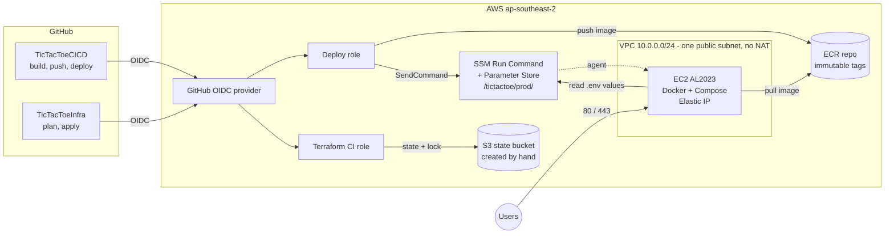

# TicTacToeCICD

A small Next.js app (register/login, tic-tac-toe against a bot, PostgreSQL) used as the workload for a
CI/CD pipeline: GitHub Actions → Amazon ECR → EC2 via AWS SSM. The pipeline is the point; see `GOALS.md`.

AWS is created by a separate Terraform repo, **[TicTacToeInfra](https://github.com/joheee/TicTacToeInfra)**.
This repo never creates AWS resources.

## Architecture



This repo is the `TicTacToeCICD` box. Everything in the AWS box comes from [TicTacToeInfra](https://github.com/joheee/TicTacToeInfra).

## Run locally

Needs Docker with Compose (Node 22 only for the dev server).

```bash
cp .env.example .env        # set POSTGRES_PASSWORD to your own value
docker compose up --build   # Postgres, migrations, then the app
```

Open <http://localhost:3000>. Health check: `/api/health` → `{"status":"ok","db":"up","version":"dev"}`.
Stop with `docker compose down` (`-v` also deletes the database).

For the dev server instead: `cp .env.example .env`, `npm ci`, `npm run db:up`, put
`DATABASE_URL=postgres://app:<password>@localhost:5433/tictactoe` in `.env.local`, then `npm run migrate`
and `npm run dev`. Never commit `.env` or `.env.local`.

| Command | What it does |
|---|---|
| `npm run lint` / `typecheck` / `test` | ESLint, `tsc --noEmit`, Vitest (no database needed) |
| `npm run db:generate` | Generate a SQL migration after changing `src/lib/schema.ts` |
| `npm run migrate` | Apply migrations to the database in `.env` |

## CI

[`ci.yml`](.github/workflows/ci.yml) runs on every pull request and on pushes to `main`. It has no AWS
access and never deploys.

| Job | Steps |
|---|---|
| Lint, type-check, test, audit | Node 22, `npm ci`, lint, typecheck, test, `npm audit --omit=dev --audit-level=high` |
| Secret scan | [gitleaks](https://github.com/gitleaks/gitleaks) over the full git history |
| Docker build and scan | Buildx build tagged with the git SHA (`push: false`), then [Trivy](https://github.com/aquasecurity/trivy); fixable HIGH/CRITICAL findings fail the job |

- The jobs run in parallel. A new push to a PR cancels its older run; runs on `main` are never cancelled.
- A push to `main` that only changes Markdown (`**.md`) skips CI, so Deploy does not run either. PRs always
  run CI so the required checks can report.
- To block merges on failures, require the three checks in branch protection for `main` (a GitHub setting).

**Supply chain**

- Third-party actions are pinned to a commit SHA (tag in a comment) and gitleaks to an image digest.
  [Dependabot](.github/dependabot.yml) opens weekly PRs; each one runs the full CI.
- Trivy exceptions go in [`.trivyignore`](.trivyignore) with a reason (empty today).
- The Dockerfile stays on Node 22 LTS to match CI: close a Dependabot PR that jumps the base image to a
  newer major. The runner stage deletes npm, npx, corepack and yarn to shrink the image and its findings.
- Checkouts use `persist-credentials: false` and the `GITHUB_TOKEN` is read-only.
- Don't add `environment:` to the deploy job: it changes the OIDC subject and the deploy role (which trusts
  `main`) would refuse the login.

Run the same checks locally:

```bash
npm ci && npm run lint && npm run typecheck && npm test && npm audit --omit=dev --audit-level=high
docker build --build-arg APP_VERSION=local -t tictactoe-app:check .
```

## Deploy

[`deploy.yml`](.github/workflows/deploy.yml) runs after CI passes on a push to `main` (never for PRs), or by
hand from the Actions tab. One deploy runs at a time.

| Step | What happens |
|---|---|
| AWS login | GitHub OIDC → the deploy role from TicTacToeInfra. No stored AWS keys. |
| Build and push | Same Dockerfile and `APP_VERSION` as CI, pushed to ECR as `<git SHA>`. Skipped if the tag exists (tags are immutable). |
| Deploy | [`deploy/ssm-run.sh`](deploy/ssm-run.sh) sends `deploy/remote/deploy.sh`, `docker-compose.yml` and the `Caddyfile` over SSM Run Command (no SSH). The instance writes `/opt/app/.env` from Parameter Store, pulls from ECR, runs the `migrate` service, then starts the app and Caddy. |
| Smoke test | [`deploy/smoke-test.sh`](deploy/smoke-test.sh): `APP_URL/api/health` must return 200 with this SHA as `version`, and `/login` must return 200. Retries for 2 minutes. |
| Mark good | Writes the SHA to `/opt/app/last_good_tag` (history in `/opt/app/deploy_history`). |
| Rollback | If deploy or smoke test fails: redeploys `last_good_tag`, smoke tests it, and the run ends red. |

**Proof.** Run [#41087349024](https://github.com/joheee/TicTacToeCICD/actions/runs/41087349024) was started
with `break_health` on. The broken image failed the smoke test (503), "Mark as last good" was skipped, and
"Roll back to last good" redeployed the previous tag with no manual step.

**HTTPS.** A Caddy container (`proxy` service, [`Caddyfile`](Caddyfile)) terminates TLS on 80/443, gets and
renews its Let's Encrypt certificate (kept in the `caddy_data` volume), redirects HTTP to HTTPS and adds
security headers (HSTS, `X-Content-Type-Options`, `X-Frame-Options`, `Referrer-Policy`,
`Permissions-Policy`, a CSP limited to framing and form targets). The CSP has no `script-src` because
Next.js hydrates with inline scripts. The app port is bound to `127.0.0.1`, so Caddy is the only way in.
The proxy is a Compose profile: off locally, on for EC2 (`COMPOSE_PROFILES=proxy`). Try it locally with
`COMPOSE_PROFILES=proxy docker compose up --build` and open <https://localhost>.

**App protection** (`src/lib/actions.ts`, `src/lib/rateLimit.ts`). Login allows 10 failed attempts per IP and
10 per username in 15 minutes; register allows 10 per IP per hour (IP from the `X-Forwarded-For` header that
Caddy sets; counters are in memory, so a deploy resets them). Login always runs a bcrypt compare, so timing
does not reveal which usernames exist. Passwords are 8 to 72 bytes.

## One-time setup

1. Apply TicTacToeInfra. It must allow inbound 80 and 443 on the instance.
2. Set the real values in Parameter Store (use a URL-safe password; it goes into `DATABASE_URL`):

   ```bash
   aws ssm put-parameter --overwrite --type SecureString --name /tictactoe/prod/POSTGRES_USER     --value app
   aws ssm put-parameter --overwrite --type SecureString --name /tictactoe/prod/POSTGRES_DB       --value tictactoe
   aws ssm put-parameter --overwrite --type SecureString --name /tictactoe/prod/POSTGRES_PASSWORD --value "$(openssl rand -hex 24)"
   aws ssm put-parameter --overwrite --type SecureString --name /tictactoe/prod/SITE_ADDRESS      --value tictactoe.johe.my.id
   ```

   Point the DNS A record for `tictactoe.johe.my.id` at the instance before the first deploy, or Caddy
   cannot get a certificate. Postgres reads these only on its first start; changing the password later also
   needs `ALTER USER`.
3. Add these repository variables (Settings → Secrets and variables → Actions → Variables) from
   `terraform output` in TicTacToeInfra:

   | Variable | Terraform output |
   |---|---|
   | `AWS_REGION` | `aws_region` |
   | `AWS_DEPLOY_ROLE_ARN` | `github_deploy_role_arn` |
   | `ECR_REPOSITORY_URL` | `ecr_repository_url` |
   | `EC2_INSTANCE_ID` | `instance_id` |
   | `APP_URL` | `app_url` (the `https://` URL) |
   | `SSM_PARAM_PREFIX` | `ssm_parameter_prefix` |

4. Re-run the latest CI run on `main`. The first deploy has no rollback target until it passes.

## Runbook

- **Deploy:** merge to `main` and watch Actions → Deploy.
- **Redeploy the current commit:** Actions → Deploy → Run workflow (leave `break_health` off).
- **Roll back by hand:** revert the bad commit on `main`; CI and Deploy ship the revert. Failed deploys
  already roll back automatically.
- **Rollback demo:** Run workflow with `break_health` on. It ships `<git SHA>-broken`, where `/api/health`
  returns 503. The site serves 503 for a couple of minutes, so don't run it while the link is being shared.
- **Parameter Store:** keep every value real, no `CHANGE_ME` (the deploy log warns about it).
- **Rotate the DB password:** `ALTER USER` in Postgres, update `POSTGRES_PASSWORD` in Parameter Store,
  then redeploy.
- **Migrations** run before the new app starts and a rollback does not undo them, so add columns as
  nullable or with defaults.
- **Look at the instance:** Systems Manager → Session Manager, then
  `sudo docker compose -f /opt/app/docker-compose.yml ps` or `logs app`. Never print `/opt/app/.env`.
- **Locked out by the rate limit:** wait 15 minutes, or redeploy.
- **Dependabot PRs:** merge a green one after a quick look at the changelog; it deploys like any change.

## Estimated monthly cost

Hand calculation for `ap-southeast-2` (730 h/month, on-demand), from the TicTacToeInfra README. Check AWS
pricing before relying on it.

| Item | USD |
|---|---|
| EC2 `t3.small` | ~19.30 |
| EBS gp3, 20 GiB | ~1.80 |
| Public IPv4 / Elastic IP | ~3.65 |
| ECR storage | <1 |
| SSM Parameter Store, OIDC, IAM, VPC, S3 state | ~0 |
| Data transfer out | small |
| **Total** | **~25** |

Left out on purpose: NAT gateway, load balancer, EKS and RDS. Postgres runs in Compose on the instance to
keep the demo cheap; managed RDS is the production upgrade.
